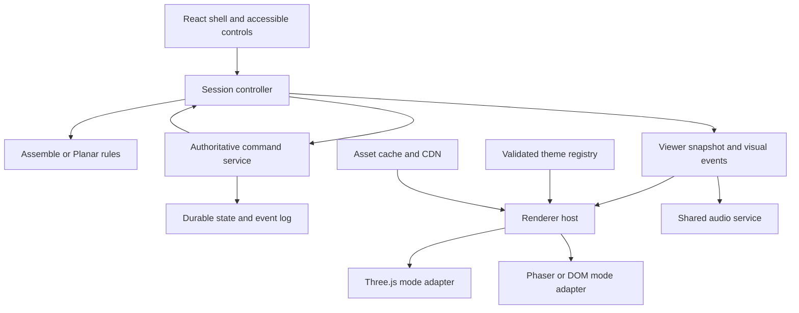

# Jigsawverse 3D Art Direction and Technical Implementation Specification

**Version:** 1.0 · **Date:** 10 October 2026 · **Status:** Proposed architecture for review

Jigsawverse should use a single Afrofuturistic universe and asset system across **Assemble** and **Planar**, with separate gameplay engines and mode-specific scene adapters. Retain the browser delivery model, React interface, and Supabase services. Introduce a lazily loaded Three.js renderer for actual 3D boards and worlds, with playable 2D presentations for unsupported or constrained devices. Do not add 3D by stacking a Three.js canvas behind an active Phaser canvas.

This specification is detailed enough to commission assets, implement interfaces, and define release acceptance. Its performance figures are engineering targets, not measurements of a completed 3D product. Implementation starts only after architecture review. No production code, repository branches, database schema, deployment, or production configuration was changed during this audit.

## 1 Scope and product boundaries

| Product boundary | Included behavior | Excluded behavior |
| --- | --- | --- |
| Assemble | Existing image assembly, board and rack, solo play, multiplayer, hints, marks, reveal policies, results | A new puzzle rule system introduced through art or renderer work |
| Planar within Jigsawverse | Current Planar Match: shifting a complete row or column by one cell, wrapping edges, runs of at least three, downward refill and cascades | Individual tile swapping, rotating six cube faces, standard Rubik algorithms |
| Shared universe | World scenes, materials, motifs, UI tokens, audio language, rewards presentation, asset tooling and quality profiles | Shared scoring or a forced common board mechanic |
| Separate Planar-Cube educational trainer | Entirely outside scope | Its repository, tutorials, cube solver, algorithms, assets, dependencies, milestones and migration |

The historical `codex/planar-cube-prototype` branch was identified in the branch inventory and deliberately not audited. It is not an implementation source for this specification. In product language, **Assemble and Planar are game families**. CLASSIC, SUPER, SAGE, NEXUS, SAVANT and SINGLE_PLAYER remain Assemble ruleset identifiers, not separate worlds. The current Planar prototype remains a solo game until an independently reviewed multiplayer design exists.

CAESAR is the parent product context. Gameplay telemetry can support exploratory research, but scores must not be presented as validated cognitive assessments without a separate validation programme.

## 2 Audit baseline and evidence

### 2.1 Revisions examined

Remote branch heads were checked through the authenticated GitHub connection on 10 October 2026. The local main and Planar revisions match the checked remote heads. The Planar branch differs from main in eight tracked files; its shared Assemble, Phaser and service files are inherited from main.

| Revision | SHA | Audit role |
| --- | --- | --- |
| `main` | `e6d2f9c6a3a462b6cde2cf2134055c824d4d69d5` | Baseline for current repository main; merge of PR 47 on 17 September |
| `codex/planar-match3-prototype` | `0c86a9b6e69597a418764adbc799da7f7cc47c69` | Current Planar implementation; latest commit 9 October |
| Remote `codex/gameplay-hints-effects` | `547f54429012fa153dad354bb8be91d33eb40a37` | Checked remote identity; not treated as main |
| Older local gameplay checkout | `6f7b47fd5cfb27aafb465dd9a36ffee4b1f2d058` | Local branch reports two commits ahead of its tracking ref; contains additional fixes not assumed deployed |

Production deployment identity, live Supabase migrations, plan quotas, RLS configuration and browser behavior were not independently verified. Main is a source baseline, not proof of what the live website serves. Other historical remote branches were inventoried rather than exhaustively audited.

### 2.2 Current architecture

| Area | Observed implementation | Implication |
| --- | --- | --- |
| Application | React 18.3, Vite 5, Tailwind; `src/components/JigsawVerseApp.jsx` contains routing and extensive multiplayer UI | Extract boundaries incrementally; no framework migration is required |
| Assemble rendering | `PhaserGame.jsx` mounts Phaser 3.90; active `BoardScene.js` combines board and rack | Replace behind an adapter, preserving gameplay behavior |
| Solo Assemble | `SinglePlayerGame.jsx` uses `GameLogic` and the same lazy Phaser wrapper | Both solo and multiplayer must receive the new presentation |
| Rulesets | `src/lib/gameModes.js` makes NEXUS and SINGLE_PLAYER available; four other rulesets are marked unavailable | Availability must remain independent of theme support |
| Image processing | `ImageProcessor.sliceImage()` generates a PNG data URL for every piece | New 3D path should use one puzzle texture with per-piece UV rectangles |
| Rack layout | `GameLogic` capacity 10; service initialization slices 10/10; `BoardScene` uses 5 columns and 2 rows | Adaptive capacity is not established on the audited main baseline |
| Planar rules | `planarMatchEngine.js`: seeded initial board, stable tile IDs, shift/match/collapse helpers | Useful foundation; preserve semantic tile identities |
| Planar orchestration | `PlanarMatchGame.jsx`: React state, timer promises, DOM rectangle capture and Web Animations | Extract logical turns from visual timing before introducing 3D |
| Planar defaults | 6 by 6; six kinds; 18 moves; target 6000; 100 points per cleared tile times cascade number | Freeze as ruleset version 1 until explicitly changed |
| Multiplayer | `multiplayer.js` Host/Guest classes send client state through Broadcast and persist updates in the background | Authority and persistence need redesign before competitive rollout |
| Alternative realtime paths | `realtime.service.js` also exposes Postgres Changes subscriptions and per-event broadcast channels | Consolidate gameplay transport; distinguish presence from authority |
| Storage | Supabase image/avatar storage and metadata services | Reuse provider capability, add a dedicated immutable asset namespace |
| Art infrastructure | No production GLB catalogue, shared theme manifest or 3D renderer in audited revisions | A pipeline and renderer are new work, not configuration changes |
| Audio | Phaser configuration explicitly sets `noAudio: true`; no shared audio service in audited baseline | Add a shared, gesture-unlocked audio service after review |

### 2.3 Prioritized findings

Severity describes release impact, not a claim that an exploit or visual failure was reproduced.

| ID | Priority | Finding and source evidence | Required disposition |
| --- | --- | --- | --- |
| A01 | P0 before ranked play | Host and Guest `makeMove()` run local rules, broadcast state, then write `game_state` and `games` asynchronously; no checked revision in this path | Server-validated commands, serialized commits and idempotent results |
| A02 | P0 before ranked play | `Players can update game state` RLS policy allows participating users to update the state row; it does not validate a move or a score | Revoke direct competitive state writes; enforce rules at trusted boundary |
| A03 | P0 before ranked play | Both clients decrement `timerRemaining` with `setInterval` in gameplay UI | Server `endsAt`; authoritative timeout and finalization |
| A04 | P1 | `exportForDatabase()` excludes `revealedScores`, next reveal threshold, `piecePlacedBy`, `pieceMarks`, `nexusResolved`; migrations inspected do not add these fields | Versioned complete state schema and reconnect parity tests |
| A05 | P1 | Broadcast includes actual `scores` alongside `revealedScores`, correct positions and both racks | Treat existing reveal as a UI policy; if hidden information is a competitive rule, implement per-viewer server projections |
| A06 | P1 | Ten-piece capacities occur independently in rules, initial service state and renderer | One explicit match-level capacity; baseline 10 initially; adaptive capacity becomes reviewed ruleset change |
| A07 | P1 | Piece texture keys use `piece_${piece.id}` and `rack_${piece.id}`, with repeated numeric IDs across puzzles | Namespace by image hash/session; verify cleanup and rapid puzzle changes |
| A08 | P1 | Per-piece PNG data URLs plus board/rack textures multiply allocations and uploads | Shared puzzle texture and UV mapping for 3D; cached frame references for 2D |
| A09 | P1 | Planar turn resolution spans component state and visual waits; reshuffle seed can change with `Date.now()` | Pure transition trace, explicit PRNG state, cancellation and deterministic replay |
| A10 | P1 | No browser or multi-client test suite found in audited tracked files | Device, screenshot, reconnect and concurrency coverage before launch |
| A11 | P2 | Build reports large Phaser chunk and mixed static/dynamic `gameLogic` import | Separate game entry chunks; prevent loading both renderers at launch |
| A12 | P2 | No theme schema, asset license ledger, asset validator or shared audio boundary | Establish tooling and ownership before commissioning multiple worlds |

A07 is a lifecycle risk requiring reproduction, not a verified cause of the previously reported flashing. A01–A05 are source-level trust and consistency findings; production database policy may differ and must be inspected before remediation.

### 2.4 Validation performed

Tests were run from isolated archived snapshots, using available installed dependencies without changing the original tracked files. Offline dependency installation initially failed because a package was absent from cache; these results are therefore checks against the available dependency tree, not proof of a clean lockfile install. A clean CI install remains a release requirement.

| Snapshot | Unit tests | Lint | Production build |
| --- | --- | --- | --- |
| Planar branch | 13 tests across 3 files passed | Passed | Passed; bundle warnings described below |
| Main | 5 tests in 1 file passed | Passed | Passed; same Phaser and mixed-import warnings |

Planar build: app JS 482.01 KB / 132.54 KB gzip; Phaser chunk 1495.75 KB / 344.91 KB gzip; CSS 52.82 KB / 9.93 KB gzip. Vite reports that `gameLogic.js` is imported both statically and dynamically and warns about chunks above 500 KB. Existing tests cover five Assemble placement cases, four Planar engine cases and four rail gesture cases. They do not establish live multiplayer security, mobile audio, rendering stability, thermal performance or tournament capacity.

Main build: app JS 463.67 KB / 126.59 KB gzip; Phaser chunk 1495.75 KB / 344.91 KB gzip; CSS 41.73 KB / 7.23 KB gzip. Both builds also report stale browser compatibility datasets; refresh these in a clean CI baseline rather than treating the warnings as rendering failures. Original tracked working trees were checked after validation and remain clean.

## 3 Shared Afrofuturistic universe

### 3.1 Universe premise

**Working world name: The Living Atlas.** Communities across an imagined future Africa preserve knowledge through crafted images and responsive lattices. Players restore images in Assemble and redirect energy through shifting lattices in Planar. Both activities take place in the same civic workshops, courtyards and observatories. The shared meaning is constructive intelligence: seeing relationships, repairing structures and discovering possibilities.

Use a bright, tactile future made by people: clay, stone, woven structures, brass, indigo dyes and restrained luminous technology. Architecture should show purpose through shade, ventilation, water management, workshops and gathering spaces. This is an original universe; avoid reproducing Wakanda costume, insignia or architecture. Afrofuturism is the conceptual reference, not a license to copy a franchise or flatten Africa into a single decorative culture.

The 10–12 pilot audience should see generous shapes, legible interfaces and playful mechanisms. Avoid babyish mascots and a militarized science-fiction tone. Characters and crowds are optional later assets; launch quality must not depend on animation-heavy humans.

### 3.2 Visual grammar

| Element | Production direction | Gameplay constraint |
| --- | --- | --- |
| Silhouette | Broad stepped forms, rounded bevels, frames with clear structural joints | Pieces and controls remain distinguishable at small sizes |
| Materials | Matte clay/stone, satin brass, indigo textile, limited emissive inlays | No glass refraction, heavy metallic reflections or shiny glare on puzzle faces |
| Motifs | Documented weaving rhythms, courtyard geometry, water channels and researched symbol families | Ornament stays outside the active puzzle face and does not resemble placement hints |
| Lighting | Warm key, cool fill, soft contact shadows; baked world lighting | No light flicker; gameplay contrast remains constant |
| Color | Indigo foundation, warm ivory text, brass/clay structure, teal energy accents | Correctness, selection and ownership must also have shapes or labels |
| Scale | Miniature crafted world surrounding a clear board pavilion | Environment never competes with the board or blocks a rail |
| Motion | Short purposeful snaps, rigid rail translations, restrained celebrations | No camera shake, full-screen flashes or result-dependent correctness leaks |
| Sound | Tactile taps, wood/metal resonance and original layered musical cues | Quiet mix, explicit mute, no sound needed to understand an action |

### 3.3 Base tokens

| Token | Hex | Role |
| --- | --- | --- |
| `surface.deep` | `#111827` | App backdrop and dark panels |
| `surface.indigo` | `#29264D` | Board surround and control surfaces |
| `text.primary` | `#FFF5DF` | Primary text |
| `text.secondary` | `#C7D2DF` | Secondary text |
| `material.brass` | `#D7AA55` | Nonsemantic trim |
| `material.clay` | `#BD7658` | World structure |
| `accent.energy` | `#4BDAC5` | Focus and active rails |
| `state.warning` | `#F4B860` | Warning with text/icon |
| `state.error` | `#EE806D` | Error with text/icon |

Token pairs must pass measured contrast at their actual opacity and background: 4.5:1 for normal text, 3:1 for large text and essential controls. The palette is an art starting point, not automatic accessibility certification. Planar's six kinds preserve `sun`, `river`, `seed`, `ember`, `indigo`, `clay` and each gets a unique silhouette/glyph as well as color. Runtime matching uses the kind ID, never the artwork.

### 3.4 Theme catalogue and design sequence

| Theme | Art and cultural research brief | Assemble expression | Planar expression | Order |
| --- | --- | --- | --- | --- |
| Atlas Workshop | Original indigo, clay and brass civic workshop; no borrowed sacred symbol needed | Image restoration table with brass frame | Same table with luminous rail mechanism | Vertical slice and first release |
| River Courtyard | Water, shade, floating walkways; research specific Niger Delta references before using named forms | Picture table beside shaded water channel | Rail lights echo the flow of channels | Second theme proves reuse |
| Loom Observatory | Textile structures and pattern instruments; Adinkra motifs only with documented meaning and contextual review | Woven surround, neutral image plane | Kind glyphs remain stable inside a woven lattice frame | Later theme |
| Civic Futures | Researched city scenes, performance venues, palaces or conservation sites | Licensed images and restoration rewards | World progress visualized by activated infrastructure | Content roadmap after core release |

Real landmarks, religious buildings and identifiable cultural objects need separate reference and permissions review. They are not launch dependencies. Each named motif has a ledger entry with community/region, meaning, source, rights, allowed transformations, reviewer and final disposition. Include a local cultural reviewer for each reference set rather than treating one person as representative of the continent.

## 4 Scene and interaction specification

### 4.1 Shared screen composition

React DOM owns navigation, scoreboard, timer, settings, results and accessible controls. The central play viewport contains exactly one active renderer. In portrait, use header, board, mode controls/rack and collapsed utilities. In landscape, utilities may occupy a side panel; board and rack remain a coherent unit. Decorative world elements stay in the viewport perimeter. Results replace or overlay gameplay only after final state is settled.

Use a perspective camera for a world lobby or reward reveal. Use a fixed orthographic camera for both playable boards. Assemble's puzzle face and Planar's row/column arrangement remain front-facing; raised edges and world depth provide 3D. Any slightly tilted premium board option requires readability and input testing and cannot be the only presentation. No free orbit while playing.

Fit camera bounds to available viewport space, board dimensions and active controls. Reserve safe areas and ensure DOM overlays cannot steal board gestures. Pointer mapping is screen → normalized device coordinates → board plane → integer row/column. Resize recomputes camera and layout, never rules or tile identities.

### 4.2 Assemble

Preserve existing rule eligibility, check/pass flow, Nexus marks and reveal milestones. The 3D board uses a reusable tray/frame, shared beveled tile geometry and one original image texture. Tile top faces sample their immutable image region; side faces use a shared neutral material. No motif overlays on the image itself.

Batch Assemble tile bodies in an `InstancedMesh` using one shared opaque material. Batch image tops as instanced quads with a per-instance UV rectangle attribute and a small application-owned shader that samples the shared image. Keep a stable instance-to-piece-ID table for picking and update instance transforms for rack/board movement. This avoids a separate material/draw call for every image fragment and makes the low-tier draw-call cap credible at 15 by 15. Version and test the shader's color-space output against the chosen Three.js release. Asset files themselves do not embed executable shaders. Selection and marks use separate bounded overlay batches. For Planar, use six kind batches and a shared glyph atlas; do not create a unique material for each tile.

Selection is a visible rim and a slight lift, about 0.08 cell units. A neutral accepted placement travels or snaps in 120–180 ms. Correct/incorrect visual grading is emitted only when the ruleset authorizes disclosure; deferred-score play uses identical movement and sound for unrevealed placements. Score particles, reward intensity, vibration and telemetry visible to other clients must not expose hidden correctness before reveal.

Keep select-piece then tap-cell behavior available. Dragging is an optional input path after parity tests, not a required rule change. A hint identifies a specific piece and permitted destination only after the hint is committed and charged once. Nexus suspect/confident marks have separate readable icons and ownership labels.

Initially preserve the audited ten-piece rack. Its viewport may resize, scroll or paginate without changing which pieces a player owns. If adaptive rack capacity is approved, define `rackCapacity` in the immutable match configuration, share it with rules/services/layout and introduce a new ruleset version. Never make capacity a side effect of viewport width or device quality; opponents must play the same distribution rules.

Image orientation must be identical across renderers: normalize browser orientation during ingestion, store width/height and crop convention, derive UV rectangles from explicit rows/columns, and test asymmetric corner markers. Use gutter extrusion or safe texel insets to avoid mipmap bleed. The puzzle image remains unchanged by tone mapping; use a calibrated unlit face material and compare against the DOM reference.

### 4.3 Planar

Interaction belongs to outer rails or accessible direction buttons. Tiles cannot be individually dragged or swapped. One command moves all tiles in one row/column by exactly one cell. Track IDs through movement; do not regenerate IDs or keys for a shift.

Wrapping uses a temporary visual duplicate at the departing/arriving seam, clipped to the board, with exactly one logical tile. It must not animate diagonally across the board. Use a shared tile geometry instanced in six batches by kind, and keep selected-line transformations synchronized. Cascade removal and refill use the engine's trace, not physics collisions.

| State | Proposed visual duration | Required semantic behavior |
| --- | --- | --- |
| Rail preview | Follows pointer | No logical move; release below threshold cancels |
| Shift | 240–280 ms | Whole line moves rigidly; one move consumed |
| Match emphasis | 100–140 ms | Exact matched indices, including seam matches |
| Clear | 140–200 ms | Clear each unique tile once even at intersecting runs |
| Collapse and refill | 240–300 ms | Survivors fall vertically; generated tiles enter from top |
| Settle | 50–80 ms | Next cascade or ready state; no extra user command during resolution |

Version 1 preserves spending a move even when a shift makes no match, terminal evaluation after the move budget is exhausted, score calculation and the existing dead-board reshuffle policy. Any early win, special tiles, boosters or different gravity is a game design change requiring review. Remove wall-clock randomness from reshuffles; store PRNG state and serial counters. Bound cascade resolution to 100 cascade steps; if exceeded, record diagnostics and use a deterministic replacement board without granting extra score. This cap must be recorded in the new versioned ruleset and tested before migration.

Reduced-motion presentation commits logical outcomes immediately, uses static highlights and short fades, and skips world movement. Logical move processing and score totals cannot depend on animation duration, frame rate or a hidden tab.

## 5 Rendering architecture and decisions

### 5.1 Architecture decisions

| Decision | Selected approach | Rationale and alternatives |
| --- | --- | --- |
| Runtime | React shell plus Three.js `WebGLRenderer`, with mode adapters | Fits the existing app and isolates rendering; avoid a Unity WebGL rewrite of services and UI |
| React integration | Imperative Three.js renderer hosted by a small React lifecycle wrapper | Mirrors the existing Phaser boundary and avoids coupling domain logic to scene components |
| React Three Fiber | Optional later substitution behind the same adapter | Not required for launch; if chosen, React 18 pairs with Fiber 8, while Fiber 9 pairs with React 19 [S1] |
| Renderer migration | Mutually exclusive Phaser/Three.js for Assemble; mutually exclusive DOM/Three.js for Planar | Existing presentations remain playable fallback; two active WebGL engines add memory and lifecycle risk |
| World strategy | True 3D modular environments; static poster for fallback | Do not require an explorable open world for puzzle play |
| Physics | No gameplay physics engine | Exact cells and traces determine placement/cascades; physics would introduce ambiguity |
| State | Renderer-independent rules plus authoritative multiplayer commands | Meshes and animations never decide scores or match legality |
| Asset delivery | GLB, KTX2 where measured beneficial, immutable hashed URLs | Standard delivery and reusable geometry/materials [S2] |
| Initial graphics backend | WebGL2 with capability fallback | WebGPU may be explored later; it is not a release prerequisite |

At implementation start, pin an exact tested Three.js version and decoder versions in the lockfile. Do not combine a graphics migration with React or bundler major upgrades. Audit dependencies and verify browser support separately.

### 5.2 Dependency topology



Arrows are data/dependency relationships. Only one renderer adapter is mounted per game. The authoritative service also runs validated rules for multiplayer; a local engine can preview results but cannot settle a ranked outcome.

### 5.3 Proposed modules

These are proposed paths, not files created by this audit.

| Module | Responsibility | Existing source to adapt |
| --- | --- | --- |
| `src/domain/assemble/` | Rules, explicit configuration, transitions and projections | `gameLogic.js`, `gameModes.js`, `gameConfig.js` |
| `src/domain/planar/` | Serializable PRNG, transitions, trace and objectives | `planarMatchEngine.js`; logic from `PlanarMatchGame.jsx` |
| `src/game/session/` | Pending commands, reconcile, reconnect, cancellation, results | Host/Guest orchestration in `multiplayer.js` |
| `src/game/input/` | Board coordinates, selection, rail input, keyboard | Existing Phaser callbacks and `planarMatchInteraction.js` |
| `src/rendering/contracts/` | Shared snapshot, visual event and lifecycle contracts | New boundary |
| `src/rendering/three/` | Renderer host, cameras, resource ownership and mode adapters | New implementation |
| `src/rendering/fallback/` | Phaser Assemble and DOM Planar adapters | `PhaserGame`, `BoardScene`, current Planar CSS |
| `src/themes/` | Validated manifests, stable registry, CSS token bridge | New theme engine |
| `src/assets/` | Asset registry/cache, texture ingestion, capability tiers | Storage services plus new loader |
| `src/audio/` | One AudioContext, unlock, mute, bounded voice count | New shared service |
| `tools/art/` | Export, validation, compression and reports | New build tooling |
| `supabase/functions/` and migrations | Trusted command handler and atomic commit | New reviewed backend work |

Extract `ImageProcessor` from the rules module because it depends on browser DOM/canvas. Server rules must not import Phaser, React, `document`, FileReader or a browser image loader. Add TypeScript contracts at new boundaries without requiring immediate conversion of the entire JavaScript codebase.

### 5.4 Required contracts

Illustrative TypeScript below is a contract specification; it is not deployed implementation.

```ts
type GameFamily = 'assemble' | 'planar';
type Quality = 'fallback' | 'low' | 'medium' | 'high';

interface SessionConfig {
  family: GameFamily;
  rulesetId: string;
  rulesetVersion: number;
  rows: number;
  cols: number;
  rackCapacity?: number;
  imageAssetId?: string;
  seed?: number;
  themeId: string;
  themeVersion: string;
}

type GameCommand =
  | { type: 'place'; pieceId: string; cell: number }
  | { type: 'mark'; cell: number; mark: 'suspect' | 'confident' }
  | { type: 'check'; decision: 'check' | 'pass' }
  | { type: 'hint'; hintKind: string }
  | { type: 'shift'; axis: 'row' | 'column'; index: number; direction: -1 | 1 };

interface CommandEnvelope {
  commandId: string; // UUID; retries reuse it
  gameId: string;
  expectedRevision: number;
  command: GameCommand;
  // Actor is derived from verified authentication, not this payload.
}

interface RendererAdapter {
  mount(container: HTMLElement, input: InputSink): Promise<void>;
  applySnapshot(snapshot: ViewerSnapshot): void;
  play(events: VisualEvent[], signal: AbortSignal): Promise<void>;
  setTheme(theme: ResolvedTheme): Promise<void>;
  setQuality(profile: Quality): void;
  resize(width: number, height: number): void;
  pause(): void;
  resume(): void;
  dispose(): void;
}
```

`ViewerSnapshot` is a read-only discriminated union with `family`, `revision`, `config`, logical board cells, status, visible scores, authorized hints/marks and viewer rack. Assemble pieces use stable IDs with immutable UV data resolved separately; Planar tiles use stable IDs and kind IDs. Server-only answers and unrevealed totals are absent when the rules require secrecy. Snapshot is plain serializable data; no meshes, data URLs, closures or DOM rectangles.

The legacy adapter explicitly normalizes numeric Assemble IDs, including zero, to canonical string IDs at the boundary and maps back only where legacy APIs require it. Never use truthiness to test whether an ID exists. UV resolution uses an approved viewer asset mapping; a competitive private-answer design must not accidentally expose solution coordinates through that mapping. Visible puzzle fragments can be provided in a shuffled atlas whose fragment ID does not encode its correct destination.

`VisualEvent` contains an event ID, command ID, committed revision, family, type and typed payload. Assemble types include neutral placement, authorized reveal, rack refill, hint, mark and result. Planar types include line shift, match, clear, fall, refill, reshuffle and result. Moves and falls include from/to cell indices and IDs; the scene derives coordinates. `InputSink` submits semantic selections or commands and cannot mutate the authoritative snapshot.

Accepted server results include the command ID, committed revision and viewer projection. Rejected results use stable codes such as `STALE_REVISION`, `NOT_YOUR_TURN`, `NOT_IN_RACK`, `CELL_OCCUPIED`, `GAME_ENDED`, `RATE_LIMITED`. Rejection reconciles the preview without adding a score or consuming a turn twice.

### 5.5 Lifecycle and animation

Initialize one renderer per viewport, update scene resources incrementally and retain stable objects by tile/piece ID. Reuse geometry and materials; use instancing for repeated forms. One application clock drives visual interpolation. React updates snapshots/HUD at semantic changes; do not call React state setters every animation frame.

Render on demand while settled and render continuously only during an active animation. Pause decorative motion on hidden tabs. Consume visual events once using event IDs; on reconnect, show the latest snapshot directly rather than replaying old celebrations. Cancel active traces on reset, exit, session switch or newer incompatible snapshot. Async asset callbacks must check the session generation before inserting objects.

Resource ownership is explicit: the asset cache owns shared textures/geometries with reference counts; a scene owns instances, render targets, subscriptions, timers and callbacks. Dispose only after the final reference is released. Dispose GPU resources and close owned ImageBitmaps; garbage collection alone does not free all graphics resources [S3]. Context loss cancels interaction previews, preserves logical state and attempts recovery once; repeated loss switches to playable fallback.

If WebGL is unavailable, force the Assemble fallback to Phaser's Canvas renderer rather than retrying `Phaser.AUTO` indefinitely; Planar uses its DOM adapter. If a device supports neither a viable canvas nor the semantic interaction view, show a recoverable compatibility screen before accepting a command. Switching quality or renderer during play reconstructs from the settled snapshot and never starts another match.

## 6 Theme engine specification

Theme selection changes presentation, never moves, scoring, hint costs, rack ownership, PRNG or puzzle solution. The same theme supports both families through mode configuration over shared assets. Quality chooses equivalent lower-cost variants. A user can use fallback art while an opponent uses 3D without receiving a different ruleset.

### 6.1 Manifest shape

```json
{
  "schemaVersion": 1,
  "id": "atlas-workshop",
  "version": "1.0.0",
  "displayName": "Atlas Workshop",
  "supportedFamilies": ["assemble", "planar"],
  "tokens": {
    "surface.deep": "#111827",
    "text.primary": "#FFF5DF",
    "accent.energy": "#4BDAC5"
  },
  "shared": {
    "environment": "world.atlas-courtyard",
    "frame": "board.atlas-frame",
    "tileBody": "tile.beveled",
    "poster": "poster.atlas",
    "audioBank": "audio.atlas"
  },
  "modes": {
    "assemble": { "tray": "tray.assemble", "imageTreatment": "neutral" },
    "planar": { "rail": "rail.planar", "kindSet": "kinds.planar-v1" }
  },
  "qualityProfiles": {
    "fallback": { "world": "poster", "shadows": false, "particles": 0 },
    "low": { "world": "lod2", "shadows": false, "particles": 16 },
    "medium": { "world": "lod1", "shadows": false, "particles": 48 },
    "high": { "world": "lod0", "shadows": true, "particles": 96 }
  }
}
```

Asset IDs resolve through a separate versioned registry containing hashed URL, bytes, content hash, MIME type, bounds, triangle/material counts, variants, license ID and dependencies. Themes cannot point to arbitrary unapproved URLs, execute scripts, override rules or attach event handlers. Use strict runtime schema validation, reject unknown required versions, cap entries/payload sizes and fall back to the embedded default manifest on error.

An asset entry declares fallback representations explicitly: `glb` per LOD, optional KTX2 texture profile, and a WebP poster or sprite equivalent. Normal/high assets must never be fetched on a fallback path. All six Planar kind IDs are required; a glyph set that makes kinds indistinguishable fails validation.

### 6.2 Resolution and switching

Resolve requested theme → compatible schema/family → pinned version → capability/quality → asset variants. Validate all required asset references and total size before activation. Preload the minimal bundle, build replacement resources, then atomically switch on an idle board. Keep current theme active if preparation fails. Do not switch mid-cascade or placement. Abort obsolete loads and limit concurrent theme preparation to one.

The session pins theme version for consistent event presentation; optional personal fallback does not alter that version or gameplay. Theme versioning uses semantic versions: patch for compatible visual fixes, minor for additive assets, major for incompatible manifest or meaning changes. Never overwrite hashed bytes. Promotion and rollback change a registry pointer; active games keep their pinned assets available.

## 7 Reusable asset production pipeline

### 7.1 Deliverable structure and ownership

Keep editable Blender/source art and large originals in a dedicated asset repository or object storage with version history; use Git LFS where suitable. Keep the runtime registry, tooling and small fixtures with Jigsawverse. Avoid committing large `.blend` files to the application history. The art lead owns visual approval; technical artist owns export/compression; engineering owns runtime compatibility and budgets; cultural reviewer owns reference disposition; QA owns cross-device acceptance.

Every asset handoff includes source, export settings, GLB/texture variants, preview from the standard camera, bounds/pivot metadata, LOD report, license/reference record and validation output. Commissioning agreements must cover editable source and rights to modify and ship in games/marketing. Generated concepts can inform direction, but do not replace clean mesh topology, UVs or rights review for production.

### 7.2 Authoring conventions

| Property | Required convention |
| --- | --- |
| Units | World assets use meters; runtime board cell equals 1 unit, module transforms map authored dimensions to cells |
| Coordinates | Export glTF Y-up; board surface XZ; row increases toward +Z; column toward +X; canonical camera above board |
| Origins | Tile body pivot at bottom center; tray/frame at board center; environment modules at documented ground anchors |
| Transforms | Apply authoring scale/rotation; test final export orientation rather than assuming Blender axes |
| Tile proportions | Default width/depth 0.92 cell, body height 0.08–0.12; consistent silhouette across kinds |
| Naming | Stable asset ID such as `tile.beveled`; source names `JV_category_name_v###`; nodes `root`, `mesh_*`, `anchor_*` |
| LODs | LOD0/1/2 share origin and silhouette; approximate 100/50/20 percent geometry, validated visually |
| UVs | No unintended overlap for baked surfaces; atlas padding and mip-safe gutters; image-top UV separate from side material |
| Materials | Shared opaque standard/unlit materials; maximum 2 for a tile; no embedded custom shaders |
| Textures | Base color/emissive in sRGB; normal/roughness/metalness in linear data space; mipmaps for 3D [S4] |
| Animation | Named clips for hero assets only; gameplay movement computed from trace; no rig per tile |
| Collision | Simple interaction bounds; decorative geometry excluded from input raycasts |

Asset exports must not contain cameras/lights used accidentally as runtime defaults. Animation sample rate is 30 fps for baked hero clips; skeletal assets require a separately approved bone budget. No skinned characters are needed in the first theme.

### 7.3 First reusable kit

| Kit component | Initial count | Reuse |
| --- | --- | --- |
| Beveled tile body | 1 mesh with tier variants | Both families; Planar kinds vary top/glyph material |
| Board frame kit | 4 modules: edge, corner, base, separator | Resizable grids in both families |
| Rack tray | 1 modular tray | Assemble; no semantic capacity in mesh |
| Rail mechanism | 2 modules: rail and direction marker | Planar rows/columns, rotated and instanced |
| Planar kind symbols | 6 original vector glyphs plus atlas | 2D and 3D representations preserve same identity |
| Civic world kit | 8 modules: paving, wall, arch, canopy, planter, channel, plinth, light | Shared lobby, both game scenes and second-theme variants |
| Decoration | 4 small props | Perimeter only; omitted on low tier |
| Hero object | 1 Atlas instrument | Lobby/results; not necessary during play |
| UI family | 12 functional icons plus focus/selection/mark frames | DOM and texture-atlas outputs from one source |
| Audio | 8 cues: select, neutral place, rail shift, clear, cascade, hint, result win, result loss | Event-driven shared bank |
| Fallbacks | 1 world poster and 1 symbol/control atlas | Playable 2D paths and missing-asset recovery |

Counts describe an initial commission, not permission to exceed screen budgets. Assemble source images are content assets with their own rights records, not part of the tile mesh kit.

### 7.4 Build and publication stages

1. Approve theme research, silhouettes, palette, layout and reference ledger.
2. Create graybox assets and verify actual board camera/readability in both families.
3. Author shared geometry, UVs and materials; generate LODs and 2D equivalents.
4. Export deterministic glTF/GLB from a pinned Blender toolchain. Strip unused nodes and validate accessors, transforms and bounds.
5. Run glTF Validator; optimize geometry using one supported Meshopt path. Do not ship both Draco and Meshopt decoders without a measured reason.
6. Transcode textures to KTX2 where beneficial: ETC1S for broad color surfaces, UASTC for delicate glyph/normal details after comparison. Retain WebP/PNG fallbacks. GLTFLoader requires explicitly configured compression loaders/decoders [S5].
7. Run automated budgets and license checks; capture standard-camera previews for each quality tier and both families.
8. Publish hashed assets to staging storage/CDN; promote only after visual, mobile and download tests. Runtime manifest references immutable final IDs.

CI rejects missing licenses, mismatched IDs, absent fallback files, unsupported glTF extensions, external unapproved texture URIs, oversize dimensions, excessive materials/triangles, wrong pivots, invalid glyph coverage and missing content hashes. Compression is a measured choice; simple vertex-colored geometry can be smaller and faster without compression.

## 8 Performance and delivery budgets

### 8.1 Proposed scene budgets

All values below are initial acceptance targets. Count draw calls and submitted triangles for the whole active scene, including particles, tile instances and shadows. Estimated GPU memory includes textures, geometry and render targets; browser APIs do not provide a uniformly accurate GPU memory reading, so retain a resource accounting model and validate stability on devices.

| Budget | Fallback | Low 3D | Medium 3D | High 3D |
| --- | --- | --- | --- | --- |
| Gameplay target | 30 fps where animated | 30 fps sustained | 60 fps target | 60 fps target |
| p95 frame interval during fixed trace | ≤50 ms | ≤40 ms | ≤20 ms | ≤20 ms |
| Scene draw calls | No Three.js scene | ≤60 | ≤100 | ≤150 |
| Submitted triangles | No Three.js scene | ≤60,000 | ≤120,000 | ≤220,000 |
| Estimated GPU resources | ≤48 MiB for Phaser path | ≤64 MiB | ≤96 MiB | ≤128 MiB |
| Maximum texture side | 1024 normally | 1024 normally | 2048 | 2048 |
| Device pixel ratio cap | 1 | 1 | 1.5 | 2 |
| Live shadows | None | None | None by default | One directional map, ≤1024 |
| Postprocessing | None | None | None by default | One restrained effect only within budgets |
| Max simultaneous particles | 0–8 | 16 | 48 | 96 |

Assemble puzzle image can be up to 2048 pixels on low tier when needed for large boards, provided the total memory cap holds; otherwise downsample and provide zoom. A 2048 by 2048 RGBA image with a full mip chain is about 21.3 MiB uncompressed, so download size is not a proxy for texture memory. Simple tile body ≤160 triangles per instance low and ≤320 high; planar kind detail uses atlases/flat geometry, not complex meshes. Environment kit per visible module ≤2000/1000/400 triangles by LOD; hero instrument ≤8000/4000/1600.

### 8.2 Download and responsiveness targets

| Measurement | Proposed gate |
| --- | --- |
| Shell JS | ≤180 KB gzip, excluding lazy game renderer |
| Active Three.js game JS including decoders | ≤350 KB gzip; measure actual bundle before committing to optional libraries |
| Initial low-theme graphics | ≤600 KB transferred |
| Optional full low-theme bundle | ≤1.5 MB transferred; never blocks first playable board |
| Optional high-theme bundle | ≤4 MB transferred; explicit preload after gameplay readiness |
| Default puzzle image | ≤300 KB transferred; custom image normalized before play |
| Input visual acknowledgement | ≤100 ms p95 on physical baseline devices |
| Warm board ready | ≤1.5 seconds p75 on baseline device/network |
| Cold board ready | ≤8 seconds p75 at 1.5 Mbps, 150 ms RTT; includes selected renderer, minimum theme and default image |
| Gameplay asset loading | Board first; no network fetch required per move |

The audited Phaser fallback chunk alone is ~345 KB gzip. Do not pretend it already meets the new shell or 3D budget. Keep it lazy; measure migration bundles independently. A 600 KB art budget plus renderer, shell and image may approach the cold-load gate under constrained bandwidth; if staging misses the gate, use a procedural board first and defer world art.

Use hashed URLs with long immutable cache headers and a short-lived version registry. Self-host decoders with the tested renderer version; set content types and CORS correctly. Download one common puzzle image per client, never piece images in realtime packets. A service worker is optional later; initial caching should work through HTTP caching without introducing stale app/manifest combinations. A cache manager must respect storage quota errors and use least-recently-used eviction; cache failure cannot block play.

### 8.3 Tier selection and devices

Capability test WebGL2, initialization and required texture decoder support. Start at low quality, then use measured frame time to upgrade only when stable. Hardware hints are advisory. Downgrade one tier after a rolling five-second p95 misses its threshold twice; use a 30-second cooldown and do not upgrade during an active match. User quality selection and reduced motion override decoration choices. Missing compressed-texture support uses supported transcode output or uncompressed fallback, not a crash.

Minimum physical test matrix: a 3–4 GB RAM budget Android from a locally common Tecno/Infinix class, a midrange Android, an iPhone Safari device including an older supported model, Windows integrated graphics Chrome/Edge and macOS Safari. Record exact model, OS, browser and GPU for repeatability. Test 360 by 640 portrait, 390 by 844 portrait, tablet, desktop and orientation changes. Emulation supplements physical tests but cannot certify thermals or Safari graphics behavior.

## 9 Multiplayer and tournament implementation

### 9.1 Authoritative move path

For ranked Assemble, introduce a trusted edge/server command handler that verifies the user session, loads server state and evaluates the versioned rules. An atomic database commit routine locks the game row, checks the expected revision and deadline, commits state/event/projections/results together and enforces unique `(game_id, command_id)`. If server computation occurs outside the lock, the commit uses compare-and-swap revision checking; a conflicting evaluation must be recomputed from fresh state. No stale result may be committed.

Clients submit intent, not replacement scores or grids. Only trusted service code can mutate competitive state. Restrict commit RPC execution to the service role, use a safe fixed `search_path` for privileged functions and derive actor ID from verified authentication. The browser never receives a service-role key. State projections are read-only to participating clients.

For simultaneous Nexus moves, serialize commit order, validate rack ownership and cell availability, and reject the second conflicting command with a fresh revision. Unique piece assignment and one placement per piece are invariants. No client timestamp grants priority. A retried accepted command returns its prior result without another score or effect.

### 9.2 Projections and reveal policy

Distinguish **deferred display** from **secret information**. Current clients receive correct positions and actual scores, so current reveal mechanics hide UI, not data. Keep this distinction explicit during architecture review. If competitive secrecy is approved, server-only solution/true scores/foreign racks must not appear in snapshots, Broadcast, diagnostics or API responses. Visible opponent marks/scores are deliberately projected. The image itself still allows human inference; server projections prevent direct answer data exposure rather than promising an unsolvable anti-cheat system.

Persist full canonical state: board, ownership, rack/pool, mode/ruleset version, scores, revealed scores, marks, placement owners, turn/check counters, pending decision, reveal threshold, PRNG where applicable, result status and revision. Use one schema version and validate imports; migration compatibility is explicit rather than silently discarding mode metadata.

### 9.3 Transport and recovery

Continue using Supabase Auth, PostgreSQL and private Realtime Broadcast. Broadcast only server-committed projections/events to authorized game/player topics. Default database-change broadcast helpers can send full rows; do not broadcast a row containing private answers. Publish sanitized per-viewer payloads from a trusted publisher/outbox. Supabase recommends Broadcast for scalable database-change subscriptions and requires authorization for private channels [S6].

Each client deduplicates events and checks monotonically increasing revisions. Missing revisions trigger a fresh authorized snapshot. Connection join loads a snapshot, subscribes, then confirms revision to close the fetch/subscribe race. Persist commands and an outbox in the same transaction; publication retries are idempotent. WebSocket delivery is not the source of truth. On acknowledgement timeout, retry the same command ID after reconnect; do not create another move.

Do not continue ranked commands offline. Show reconnecting state and preserve selection; block submission until reconciliation. Solo Assemble/Planar can continue after their local assets have loaded. Presence indicates connectivity, not score authority or immediate forfeiture. Competitive forfeiture policy uses server timestamps and a configurable grace period, reviewed with tournament operations.

Store server `startedAt` and `endsAt`; clients display an estimated countdown using server clock offset. Server rejects late commands and finalizes once. Final state, winner and leaderboard entries commit idempotently. Animated results may finish later without changing outcome.

### 9.4 Capacity model

Load target: **500 simultaneously connected players in 250 two-player games**, with a separately tested extension to 1000 players. This is a proposed load test, not verified Supabase capacity. Assuming 0.5 accepted moves per second per game gives 125 commits/second. If a sanitized event averages 1 KB and reaches two players, application event payload traffic is roughly 250 KB/second before framing, presence, retries, snapshots and spectators. Measure actual payloads and configured provider limits.

Partition topics by game/player; do not put all players in a tournament-wide state channel. Presence heartbeats remain infrequent, approximately 30 seconds, and never write frame or timer ticks to the database. Sample lobby/leaderboard updates no faster than every five seconds. Spectators get a separate public projection and connection budget; do not multiply player-topic fan-out unconstrained.

Load tests cover joins in a burst, sustained moves, simultaneous Nexus collisions, 10 percent reconnecting clients, mobile network delay and result finalization. Proposed acceptance: p95 command acknowledgement ≤750 ms at 250 rooms; zero duplicate finalizations, impossible placements or cross-room data exposure; recover authoritative state within three seconds p95 after subscription restoration. Select deployment region using measured Nigerian network latency and confirm connection/message quotas before the pilot. Add an external cache only if measurements identify a bottleneck; 3D animation does not require realtime position streaming.

Planar tournament play remains a future scope item. A shared PRNG seed alone does not establish fair ranked competition: it also needs server-generated challenge configuration, versioned replay verification, timing policy, anti-tamper checks and results authority.

## 10 Accessibility audio and content safety

Keep essential controls in DOM, with keyboard actions and visible focus. Assemble supports keyboard rack selection and cell navigation; Planar supports rail focus and directional activation. Provide an accessible semantic board view without announcing every cascade frame. Use concise live-region messages at settled outcomes and restore focus after results/dialogs.

Target 44 CSS pixel essential controls. Large Assemble boards need board zoom or focus navigation because 15 cells cannot all be 44 pixels wide on a phone. Preserve cell coordinates and input mapping at zoom; hide decoration before shrinking interactions further. Ownership and Planar kinds use text/shape distinctions in addition to color.

One audio service owns AudioContext and a bounded mixer. Create/resume on a user gesture; default to the user's persisted preference, provide mute before a match and never depend on autoplay. Preload a small cue bank after unlock; handle iOS interruption/resume. Limit overlapping voices to eight and duck celebrations under interaction cues. Neither sound nor haptics can reveal correctness early. Licensed musical textures and culturally sourced instruments need records just like visual references.

Puzzle image ingestion validates file signatures, size and dimensions, normalizes orientation and strips metadata. Cap source uploads at a proposed 10 MB and 4096-pixel side before generating runtime derivatives. Enforce storage ownership and approved asset origins. Public image selection and child-facing tournament content require appropriate moderation and parental participation policies; those policies should be defined separately from rendering code. No personal child identifier is needed in graphics performance telemetry.

## 11 QA observability and acceptance

### 11.1 Required automated coverage

| Layer | Required checks |
| --- | --- |
| Domain parity | Existing placement tests; score milestones; check/pass; Nexus marks; terminal states; IDs including zero; non-square dimension handling |
| Planar trace | All row/column directions; seam/full-line/intersecting matches; stable IDs; deterministic refill/reshuffle; no-match shift; cascade cap; reset cancellation |
| Renderer parity | Same command replay yields identical logical result in 2D/3D; image corner orientation; correct picking under resize/zoom |
| Asset validation | GLB validation, budgets, node conventions, hashes, dependencies, licenses and fallback coverage |
| Theme validation | Required kind set, unknown schema rejection, missing asset recovery, idle atomic switch and pinned version rollback |
| Multiplayer | Duplicate/stale commands, concurrent same-cell moves, wrong rack, expired game, unauthorized RPC/topic, snapshot races and missing events |
| Browser | Pointer capture/cancel, keyboard focus, reduced motion, audio unlock, rotate/background/foreground, WebGL loss and load errors |
| Memory stability | 20 match resets and 10 theme switches without accumulating live textures/listeners/channels; 15-minute thermal run |
| Release | Clean lockfile install, lint, unit/integration/E2E, build, bundle gates and staged load test |

### 11.2 Telemetry

Record build/renderer/theme versions, quality tier, board-ready timing, asset failures, rolling frame percentiles, context loss, command acknowledgement, revision gaps, reconnect recovery and finalization errors. Attach random session IDs and coarse device capabilities; exclude images, true answers, access tokens and raw personal identifiers. Collect detailed frame diagnostics from a small sample; do not emit one network record per frame.

Release dashboards compare fallback and 3D by mode/device. Track hint comprehension and successful first action in moderated pilot tests, especially seam movement in Planar and neutral placement in deferred-score Assemble. Metrics describe behavior; they are not cognitive diagnoses.

### 11.3 Release acceptance

The first production 3D theme ships only when both families pass the relevant renderer parity suite, fallback is playable, reference/licensing approval is complete, measured budget gates pass on the agreed physical devices, no P0 multiplayer finding remains for ranked games and rollback is rehearsed. Solo 3D may launch earlier behind a flag if it meets solo criteria; ranked exposure must remain disabled until authority gates pass.

## 12 Phased implementation roadmap

Indicative schedule assumes one frontend/game engineer, one backend engineer, one 3D/technical artist, part-time UI/art lead and QA, plus cultural review as needed. Six two-week implementation sprints after review give an approximately 12-week plan; staffing and device findings can extend it. Acceptance gates, rather than elapsed time, determine progression.

| Phase | Deliverables and work | Exit gate | Accountable role |
| --- | --- | --- | --- |
| 0 Architecture review | Approve renderer decision, scope, rules freeze, trust model, first theme, budgets and rollout policy; identify deployed SHA and database baseline | Named approval of decisions in section 13; no production changes before this gate | Product owner and engineering lead |
| 1 Foundations and authority | Create reviewed implementation branch; extract pure engines/image processor; define snapshots/commands; complete state schema; server command transaction, private projections and deadlines; preserve current UI | Rules parity, unauthorized/stale/duplicate/concurrent tests; clean baseline CI; documented migration rollback | Backend and frontend engineers |
| 2 Shared art kit and renderer laboratory | Graybox Atlas kit; asset registry and validators; one Three.js host; capability profiles; orthographic board and fallback selection; procedural tiles in both families | Both boards mount from same theme contract; one active renderer; physical-device budgets tested | Technical artist and frontend engineer |
| 3 Assemble vertical slice | Atlas assets, shared puzzle texture, rack selection, marks, hints, authorized reveals and results; solo and multiplayer adapters; shared audio | Both Assemble paths match existing rules; reconnect and texture lifecycle suite passes; no score leak through effects | Frontend engineer and QA |
| 4 Planar vertical slice | Extract deterministic turn trace; rail previews, wrapping, cascade choreography, clipping, reduced motion and accessible controls | Full-line interaction preserved; trace replay parity and reset/background tests pass; no individual tile swapping | Frontend/game engineer and QA |
| 5 Second theme and hardening | River Courtyard variants; theme switch/rollback; art polish; performance, thermals, caching; 500-player staging load; onboarding tests with pilot demographic | Second theme added through data/assets without engine forks; 500-player and device gates pass | Art lead, backend engineer and QA |
| 6 Controlled rollout and tournament preparation | Internal → small invited cohort → 10 percent → 50 percent → general availability; monitoring, operational runbook and support rehearsal | Reviewed metrics, no unresolved launch blockers, restore path rehearsed and tournament capacity verified | Product owner and release owner |

Phase 1 backend work and phase 2 asset production may overlap after approved contracts, but frontend integration must not bypass the authority gate. Phase 3 and 4 use the same kit and renderer host; completion of one family does not count as delivery of both.

### 12.1 Art design sprints

| Art sprint | Concrete handoff | Review questions |
| --- | --- | --- |
| A Direction | One universe board, palette/material sheet, silhouette sheet, cultural ledger, portrait/landscape compositions for both families | Does it read as one original universe? Is the board still the focus? |
| B Graybox | Resizable frame, tray, rail, tile and courtyard modules; fixed-camera previews | Are rows, columns, puzzle images and kind identities clear at mobile size? |
| C First theme | Finished Atlas kit at three LODs, posters/atlases, cue bank, export reports | Do low and high tiers convey the same world and functional cues? |
| D Reuse proof | River Courtyard manifest/material/prop variants using the same functional kit | Can a new theme ship without editing game or renderer rules? |
| E Production polish | Tested lighting, glyph contrast, seam choreography, reveals/results, approved marketing captures | Does gameplay match the promotional art within the agreed device budget? |

Do not commission many detailed worlds before graybox and mobile validation. A flyer or cinematic render is an art aspiration; the playable camera and scene budget are the asset acceptance reference.

### 12.2 Feature flags and rollback

Proposed independent flags: `renderer3dAssemble`, `renderer3dPlanar`, `themeAtlas`, `themeRiver`, `authoritativeMultiplayerV2`. Defaults remain current stable gameplay until gates pass. Store game protocol/ruleset version on each match so clients never join a match with incompatible authority. Use additive migrations first, shadow-compare local/server results in staging and revoke direct writes only when the authoritative path is ready. Old client compatibility needs an explicit minimum-version policy.

Renderer rollback can return to 2D while preserving a versioned snapshot. Protocol rollback cannot redirect an in-progress authoritative match to legacy client-written state. Keep old and new matches isolated during transition. Use staged traffic and immediate kill switches for graphics failures; retain durable authoritative results. Define escalation owners, database backup/restore procedure and asset registry revert steps before rollout.

## 13 Architecture review decisions

The following are proposed defaults for review, not approvals inferred from this document.

| Review decision | Proposed default | Consequence of approval |
| --- | --- | --- |
| Scope | Assemble and Jigsawverse Planar only | No dependency or milestone for the separate trainer |
| Renderer | Imperative Three.js with existing 2D fallback | One browser architecture; no Unity migration |
| Art direction | Living Atlas with Atlas Workshop first | Commission one shared kit before additional worlds |
| Rules | Freeze current availability and Planar mechanics; rack remains 10 initially | Visual work does not silently change fairness or distribution |
| Reveal secrecy | Explicit product decision required for ranked modes | Decide UI-only reveal versus server-private answers/scores before projection implementation |
| Authority | Server-validated, atomic versioned commands for ranked Assemble | Backend migration is a prerequisite for competitive release |
| Quality | Low 3D first, measured adaptive tiers and playable fallback | Low-end mobile is a launch target |
| Planar multiplayer | Defer; solo 3D in this roadmap | No unreviewed competitive Planar extension |
| Rollout | Flags and staged cohorts | Both renderer and protocol have separate rollback paths |

After review, the first implementation ticket should establish the deployed baseline, complete canonical state and command contracts, and a reproducible parity harness. The first art ticket should produce the Atlas graybox in both gameplay camera layouts. Those two tickets make the shared direction testable before finished world production.

## 14 Source references

Repository evidence is pinned to audited commits so reviewers can distinguish source facts from proposals:

- [Repository main revision](https://github.com/Big-debs/jigsawverse/tree/e6d2f9c6a3a462b6cde2cf2134055c824d4d69d5).
- [Planar revision](https://github.com/Big-debs/jigsawverse/tree/0c86a9b6e69597a418764adbc799da7f7cc47c69).
- [Application and routing](https://github.com/Big-debs/jigsawverse/blob/0c86a9b6e69597a418764adbc799da7f7cc47c69/src/components/JigsawVerseApp.jsx).
- [Phaser wrapper](https://github.com/Big-debs/jigsawverse/blob/e6d2f9c6a3a462b6cde2cf2134055c824d4d69d5/src/components/PhaserGame.jsx) and [active board scene](https://github.com/Big-debs/jigsawverse/blob/e6d2f9c6a3a462b6cde2cf2134055c824d4d69d5/src/phaser/scenes/BoardScene.js).
- [Assemble rules and database export](https://github.com/Big-debs/jigsawverse/blob/e6d2f9c6a3a462b6cde2cf2134055c824d4d69d5/src/lib/gameLogic.js).
- [Host and Guest multiplayer](https://github.com/Big-debs/jigsawverse/blob/e6d2f9c6a3a462b6cde2cf2134055c824d4d69d5/src/lib/multiplayer.js).
- [Initial schema and RLS](https://github.com/Big-debs/jigsawverse/blob/e6d2f9c6a3a462b6cde2cf2134055c824d4d69d5/supabase/migrations/20240101000000_initial_schema.sql).
- [State persistence migration](https://github.com/Big-debs/jigsawverse/blob/e6d2f9c6a3a462b6cde2cf2134055c824d4d69d5/supabase/migrations/20260302000001_add_scores_turns_checks_columns.sql).
- [Planar engine](https://github.com/Big-debs/jigsawverse/blob/0c86a9b6e69597a418764adbc799da7f7cc47c69/src/lib/planarMatchEngine.js) and [Planar interaction/orchestration](https://github.com/Big-debs/jigsawverse/blob/0c86a9b6e69597a418764adbc799da7f7cc47c69/src/components/PlanarMatchGame.jsx).

Primary technical documentation checked on 10 October 2026:

- **S1:** [React Three Fiber compatibility](https://github.com/pmndrs/react-three-fiber) and [performance practices](https://r3f.docs.pmnd.rs/advanced/scaling-performance). Supports the version-pairing and reuse/on-demand-rendering discussion, not the proposed Jigsawverse budgets.
- **S2:** [Khronos glTF delivery format](https://www.khronos.org/gltf/) and [KTX textures](https://www.khronos.org/ktx/).
- **S3:** [Three.js cleanup](https://threejs.org/manual/pages/cleanup.html) and [GLTFLoader disposal note](https://threejs.org/docs/pages/GLTFLoader.html).
- **S4:** [Three.js color management](https://threejs.org/manual/pages/color-management.html).
- **S5:** [Three.js GLTFLoader](https://threejs.org/docs/pages/GLTFLoader.html) and [KTX2Loader](https://threejs.org/docs/pages/KTX2Loader.html).
- **S6:** [Supabase database-change subscriptions and Broadcast](https://supabase.com/docs/guides/realtime/subscribing-to-database-changes) and [Postgres Changes scaling](https://supabase.com/docs/guides/realtime/postgres-changes).

All asset budgets, world names, module paths, command schemas, device gates, capacity targets and schedule estimates are proposed Jigsawverse design decisions. They are not claims made by these external sources.
